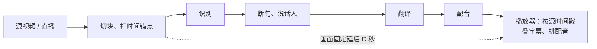

<div align="center">


# live-dub

**英语直播与视频的中文字幕和原音色中文配音**

字幕、配音与画面逐句对齐 · 直播与点播均可使用

[](https://github.com/h5box/live-dub/releases)
[](LICENSE)


[下载安装包](https://github.com/h5box/live-dub/releases) ·
[安装文档](docs/安装.md) ·
[工作原理](docs/原理.md) ·
[配置说明](docs/配置.md) ·
[参与开发](AGENTS.md)

<br>

<a href="docs/media/demo.mp4"></a>

<sub>▶ 点图看带声音的完整片段（27 秒，AV1）。素材：<a href="https://mango.blender.org/">Tears of Steel</a>（CC BY 3.0）© Blender Foundation | mango.blender.org。<br>
翻译 DeepSeek，配音 IndexTTS-2.5；字幕和配音都是程序直接输出，没有人工修改。做法见 <a href="docs/2026-10/README演示.md">README演示.md</a>。</sub>

</div>

---

live-dub 是一款个人观看用的翻译工具：把英语直播或视频翻译成中文，在画面上叠加中文字幕，
也可以用原说话人的音色念出中文配音。支持 YouTube、Twitch、m3u8 等链接和本地视频。

- **直播**：画面延后播放（默认 30 秒），利用这段时间完成识别、翻译和配音，让每句字幕和配音都对准原话。
- **点播**：先处理再播放，首段字幕就绪即可开始观看；拖到尚未处理的位置时，会优先处理那一段。

> [!NOTE]
> 目前仅支持英语译为简体中文。

## 功能

| | 环节 | 说明 |
| :---: | --- | --- |
| 🎙️ | **识别** | NVIDIA Parakeet 英文识别，带词级时间戳，CPU 即可运行；TitaNet 声纹区分说话人 |
| 🌐 | **翻译** | 本地 Index-Translate-9B（llama.cpp），或 DeepSeek 等任意 OpenAI 兼容接口 |
| 🗣️ | **配音** | IndexTTS-2.5 以每位说话人的原声为参考，按原句时长合成中文 |
| 📺 | **播放** | 字幕叠加在画面上，可切换中英 / 仅中文 / 仅原文 / 关闭；配音时自动压低原声；支持暂停、回看和点击字幕跳转 |
| 🗂️ | **历史** | 回放保留的视频、从上次位置继续，导出中文、原文或双语 SRT |
| 📡 | **OBS 输出** | 可选，将带字幕和配音的画面输出到本机 OBS |

<p align="center"></p>
<p align="center"><sub>观看页：右边逐句列出原文、译文和配音状态，点一句就从那句开始播。</sub></p>

## 使用须知

> [!IMPORTANT]
> - 本工具用于个人观看外语内容。请仅处理你有权观看的内容，遵守版权和平台服务条款，不要录制、转载或二次分发他人的内容。
> - 「输出到 OBS」只把画面交给本机的 OBS。是否推流、推往何处由你决定，相应的版权和法律责任由你自行承担。
> - 配音会克隆原说话人的音色，目的只是让译文听起来像原话。请勿用于冒充他人或制作误导性内容。
> - 所用模型各有许可，部分仅限非商业使用（例如配音链路中的 MaskGCT 语义编解码器为 CC BY-NC 4.0），详见 [THIRD_PARTY.md](THIRD_PARTY.md)。

## 工作原理

常见的同声传译工具追求低延迟：听完一句就识别、翻译、上屏、朗读，因此字幕和配音总比说话人晚几秒，而且每句晚的时间都不一样。

live-dub 反其道而行：**让整路画面固定延后 D 秒播放**，所有环节都以源视频自身的时间戳计时。



一句话在源视频中从 t0 说到 t1，只要识别、翻译和配音在 t0 + D 之前完成，画面播到 t0 时就能准时显示字幕、开始配音。

| | 低延迟同传 | live-dub |
| --- | --- | --- |
| 延迟 | 尽量小，但每句不同 | 固定 D 秒（直播默认 30 秒） |
| 字幕和配音 | 比原话晚几秒出现 | 与原话同时出现 |
| 处理方式 | 必须流式处理 | 整句处理，可利用上下文，按原句时长配音 |

来不及处理的句子会逐级降级：先去掉配音，再退回原文字幕，仍来不及就不叠加，下一句照常处理。**画面从不等待任何环节。**
详细设计见 [docs/原理.md](docs/原理.md)。

## 系统要求

| 使用方式 | 硬件 | 磁盘 |
| --- | --- | --- |
| 中文字幕（线上翻译） | 4 核以上 CPU，16 GB 内存 | 原生识别模型约 0.8 GB；NeMo 识别环境约 6 GB |
| + 本地翻译 | NVIDIA 显卡，约 5 GB 显存 | 翻译模型约 5.5 GB |
| + 中文配音 | NVIDIA 显卡，约 6.5 GB 显存 | 配音环境约 20 GB |

- Windows 默认使用原生 ONNX 识别，无需 WSL；Linux 默认使用 NeMo。
- 本地翻译与配音同时开启约需 12 GB 显存，另需为系统和播放器预留余量。
- 开发与实测环境为 Windows 11 + WSL 2（Ubuntu 22.04）+ RTX 5060 Ti 16 GB。Linux 可运行同一套代码，但测试较少。

## 安装

### Windows 安装包（推荐）

1. 从 [GitHub Releases](https://github.com/h5box/live-dub/releases) 下载并运行安装程序。
2. 打开「设置向导」，依次下载字幕组件、填写并测试翻译接口，再播放内置的英语测试片确认效果。

> [!TIP]
> 仅使用字幕时，不需要 Python、Node.js、WSL 或独立显卡；线上翻译按接口服务商的价格计费，模型存放目录可自选。
> 原音色配音为可选组件，需要 NVIDIA 显卡和 WSL 2。

### 从源码运行

以下是最简步骤，详细说明和常见问题见 [docs/安装.md](docs/安装.md)。安装过程中可随时运行环境检查，它会列出缺少的组件和补装方法：

```
uv run python -m livedub.doctor
```

<details>
<summary><b>Windows</b></summary>

1. 安装基础工具（在 PowerShell 中执行）：

   ```powershell
   winget install Git.Git
   winget install Gyan.FFmpeg
   winget install DenoLand.Deno
   winget install OpenJS.NodeJS.LTS
   powershell -ExecutionPolicy ByPass -c "irm https://astral.sh/uv/install.ps1 | iex"
   ```

   安装完成后重新打开 PowerShell，新命令才能生效。

   Deno 供 yt-dlp 通过 YouTube 的播放校验（也可用 Node.js 代替）；Node.js 用于构建界面。

2. 仅配音和 NeMo 识别需要 WSL 2：以管理员身份在 PowerShell 中运行 `wsl --install`，重启后创建 Ubuntu 用户。
   NVIDIA 驱动只需安装在 Windows 中，WSL 内无需另装。

3. 克隆代码并安装 Python 依赖：

   ```powershell
   git clone https://github.com/h5box/live-dub.git
   cd live-dub
   uv sync
   ```

4. Windows 默认使用原生 ONNX 识别：构建并启动界面后，在「设置向导」中下载模型（约 0.8 GB）。
   如需 NeMo 的识别热词增强，先将 `settings.json` 中的 `asr.backend` 设为 `nemo`，再安装：

   ```powershell
   wsl -e bash scripts/linux/setup_asr.sh
   ```

5. 翻译（二选一）：
   - 本地：`uv run python scripts/fetch.py all`，下载 llama.cpp 服务端和 Index-Translate-9B，约 5.5 GB；
   - 线上：暂时跳过，启动程序后在「环境」页填写 DeepSeek 或其他 OpenAI 兼容接口的 API key。

6. 中文配音（可选，约 20 GB）：`wsl -e bash scripts/linux/setup_dub.sh`

7. 输出到 OBS（可选）：`uv run python scripts/fetch.py mediamtx`

</details>

<details>
<summary><b>Linux</b></summary>

```bash
sudo apt install git ffmpeg curl            # 另需 Node.js（构建界面）；观看 YouTube 还需 Deno 或 Node.js
curl -LsSf https://astral.sh/uv/install.sh | sh
git clone https://github.com/h5box/live-dub.git && cd live-dub
uv sync
bash scripts/linux/setup_asr.sh             # 识别（必需）
uv run python scripts/fetch.py all          # 本地翻译（也可改用线上翻译）
bash scripts/linux/setup_dub.sh             # 中文配音（可选，需要 NVIDIA 显卡）
```

</details>

> [!TIP]
> **国内网络**：Hugging Face 下载慢可设置 `HF_ENDPOINT=https://hf-mirror.com`；PyPI 慢可将 `UV_DEFAULT_INDEX` 指向国内镜像；
> GitHub 慢可为 `scripts/fetch.py` 加上 `--github-mirror`。详见 [docs/安装.md](docs/安装.md)。

## 运行

首次运行前先构建界面（需要 Node.js，只需一次）：

```
cd app
npx pnpm install
npx pnpm build
cd ..
```

然后任选一种方式启动：

| 方式 | 启动 | 说明 |
| --- | --- | --- |
| **浏览器** | `uv run python -m livedub.server --open` | 自动打开 http://127.0.0.1:8090 ；本地视频需粘贴文件路径 |
| **桌面程序** | 在 `app/` 中运行 `npx pnpm tauri build --no-bundle` | 生成 `app/src-tauri/target/release/live-dub(.exe)`，双击即可，后端会自动启动；支持选择或拖入本地视频 |

构建桌面程序需另外准备 [Tauri 构建环境](https://tauri.app/start/prerequisites/)（Rust；Windows 还需 MSVC）。

### 使用方法

1. 在「设置向导」中安装字幕组件并测试翻译接口。然后在「观看」页粘贴链接或选择视频，点击「开始」，默认只生成字幕。
2. 场景、翻译模型、直播延时和 OBS 输出在「高级选项」中设置。勾选中文配音会自动启动已安装的配音服务。
3. 直播在延时 D 秒后开始播放；点播在首段字幕就绪后播放，进度条上的绿色区域表示已处理的部分。
   播放时可暂停、拖动进度、点击字幕跳转；直播可点击「回到实时」恢复默认位置。
4. 「历史」页可回放保留的视频、从上次位置继续、导出中文／原文／双语 SRT，也可查看占用空间、清理缓存或删除整场记录。
   清理缓存会保留字幕和统计；删除记录会移除该场的全部文件。两项操作都需要确认。

快捷键：<kbd>Space</kbd> 暂停 · <kbd>←</kbd> <kbd>→</kbd> 快退 / 快进 5 秒 · <kbd>F</kbd> 全屏

## 设置

无需设置文件即可使用，默认路径与安装脚本一致。如需修改路径、端口、默认翻译模型、YouTube cookies 等，
请参照 [settings.example.json](settings.example.json) 在项目目录新建 `settings.json`，只写需要修改的项，说明见 [docs/配置.md](docs/配置.md)。
自定义场景（术语表、热词）放在 `configs/local/`。

## 文档

| 文档 | 内容 |
| --- | --- |
| [docs/安装.md](docs/安装.md) | 安装细节和常见问题 |
| [docs/配置.md](docs/配置.md) | `settings.json`、场景预设、线上翻译的 API key |
| [docs/原理.md](docs/原理.md) | 设计与时间轴：固定延时、时间锚点、降级策略 |
| [docs/接口.md](docs/接口.md) | 后端 API，以及识别和配音服务的 HTTP 接口 |
| [AGENTS.md](AGENTS.md) | 参与开发：代码结构，以及如何在没有显卡的机器上修改界面 |
| [docs/dev/](docs/dev/) | 开发过程中的选型调研和实测记录 |

## 路线图

- [ ] 在干净的 Windows 机器上验证安装，邀请非技术用户试用，提高组件下载成功率
- [ ] 在界面中编辑场景的术语表和识别热词
- [ ] 支持更多源语言

## 许可证

本项目自有代码采用 [MIT 许可证](LICENSE)。`dubsvc/engine.py` 等第三方衍生文件沿用各自的原许可，
不在 MIT 授权范围内；完整说明和许可文本见 [THIRD_PARTY.md](THIRD_PARTY.md) 与 [licenses/](licenses/)。
模型权重不随仓库分发，其使用限制也不因本项目采用 MIT 而改变。

## 致谢

| 环节 | 项目 |
| --- | --- |
| 识别 | [NVIDIA NeMo](https://github.com/NVIDIA/NeMo)（Parakeet、TitaNet）、[sherpa-onnx](https://github.com/k2-fsa/sherpa-onnx) |
| 翻译 | [Index-Translate](https://huggingface.co/IndexTeam/Index-Translate-9B)、[llama.cpp](https://github.com/ggml-org/llama.cpp) |
| 配音 | [IndexTTS](https://github.com/index-tts/index-tts)、[vLLM-Omni](https://github.com/vllm-project/vllm-omni) |
| 媒体 | [FFmpeg](https://ffmpeg.org/)、[yt-dlp](https://github.com/yt-dlp/yt-dlp)、[streamlink](https://streamlink.github.io/)、[MediaMTX](https://github.com/bluenviron/mediamtx)、[hls.js](https://github.com/video-dev/hls.js) |
| 界面 | [Tauri](https://tauri.app/)、[Vue](https://vuejs.org/) |
